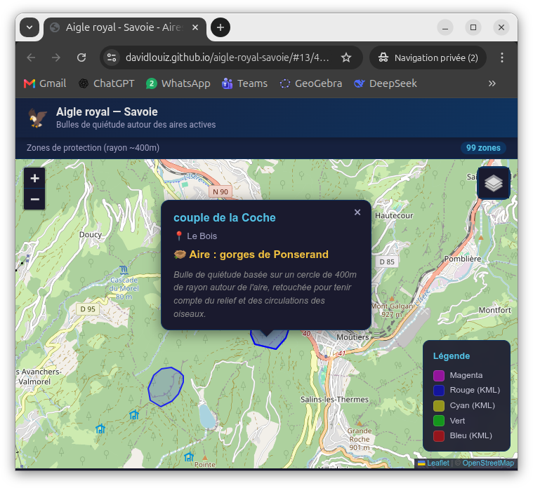

# 🦅 Aigle royal — Savoie

Carte interactive des **bulles de quiétude** autour des aires actives de l'aigle royal en Savoie.
Chaque aire est matérialisée par une zone tampon d'environ 400 m de rayon, retouchée pour tenir compte du relief et des circulations des oiseaux.



🔗 **Démo en ligne** : <https://davidlouiz.github.io/aigle-royal-savoie/>

## ✨ Fonctionnalités

- Affichage des aires actives sous forme de polygones colorés
- Popups détaillés : couple, commune, aire
- Trois fonds de carte : OpenStreetMap, OpenTopoMap et satellite Esri
- Légende des couleurs et compteur de zones
- Partage de la vue courante via le hash d'URL (`#zoom/lat/lng`)
- Chargement du KML avec repli automatique sur des proxys CORS
- Interface sombre, responsive et plein écran (mobile inclus)

## 🛠️ Technologies

| Technologie | Rôle |
| --- | --- |
| HTML5 / CSS3 | Structure et styles de l'interface |
| JavaScript (vanilla, ES6+) | Logique de chargement et de rendu |
| [Leaflet](https://leafletjs.com/) 1.9.4 | Carte interactive |
| KML / DOMParser | Format et parsing des zones |
| OpenStreetMap · OpenTopoMap · Esri | Fonds de carte |
| GitHub Pages | Hébergement de la démo |

Projet **sans framework ni étape de build** : une seule page HTML autonome.

## 📦 Structure

```
.
├── index.html                    # application complète (HTML + CSS + JS)
├── aires_actives_bulles.kml      # copie locale des zones (repli hors CORS)
└── docs/
    └── preview.png               # capture d'écran utilisée dans ce README
```

## 🚀 Lancer en local

Le KML est récupéré via `fetch`, il faut donc servir la page via HTTP (l'ouverture directe en `file://` est bloquée par le navigateur) :

```bash
git clone https://github.com/Davidlouiz/aigle-royal-savoie.git
cd aigle-royal-savoie
python3 -m http.server 8000
```

Puis ouvrir <http://localhost:8000>.

## 🗺️ Source des données

Les zones proviennent du fichier KML public :

```
https://domlibs.fr/ar73/aires_actives_bulles.kml
```

La source ne renvoie pas d'en-tête `Access-Control-Allow-Origin`, le chargement direct depuis le navigateur est donc bloqué. Une **copie locale** ([`aires_actives_bulles.kml`](./aires_actives_bulles.kml)) sert de repli : la carte fonctionne toujours. Les proxys CORS publics initialement prévus (`api.allorigins.win`, `corsproxy.io`) ont été retirés, ils sont hors service (522 / 403) et ajoutaient plusieurs secondes de chargement.

### Mettre à jour les données

```bash
curl -o aires_actives_bulles.kml https://domlibs.fr/ar73/aires_actives_bulles.kml
git commit -am "data: refresh KML"
git push
```

> Données affichées à titre indicatif.
